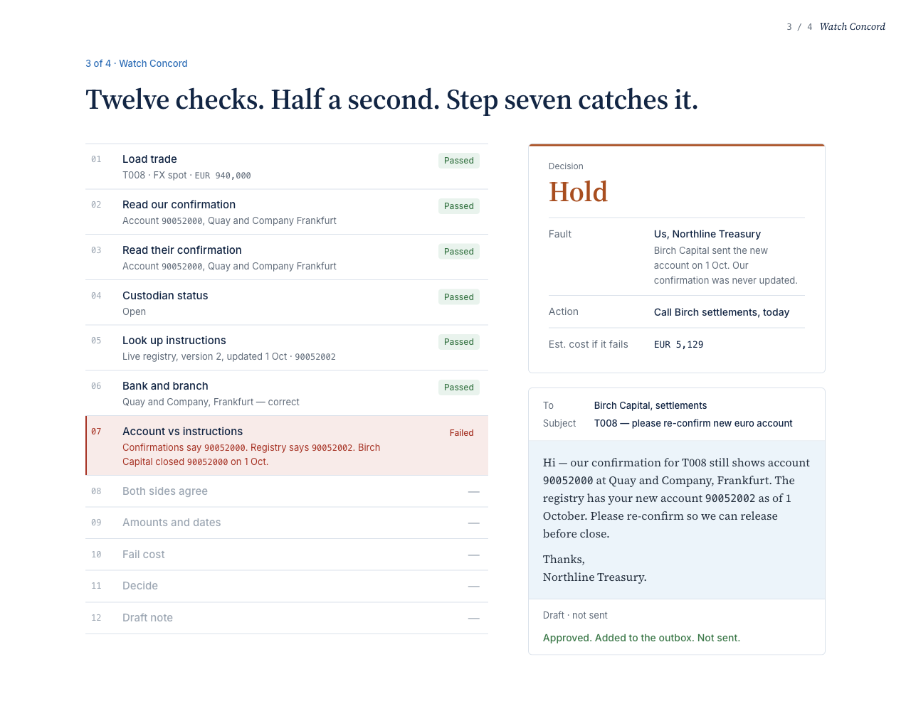
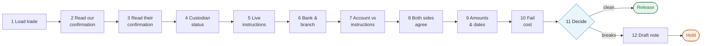
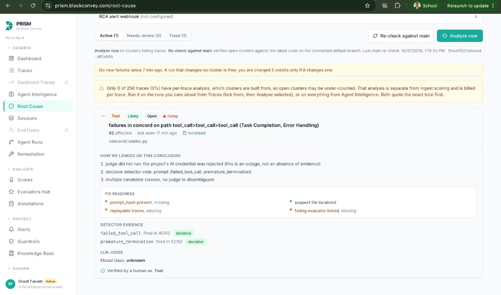
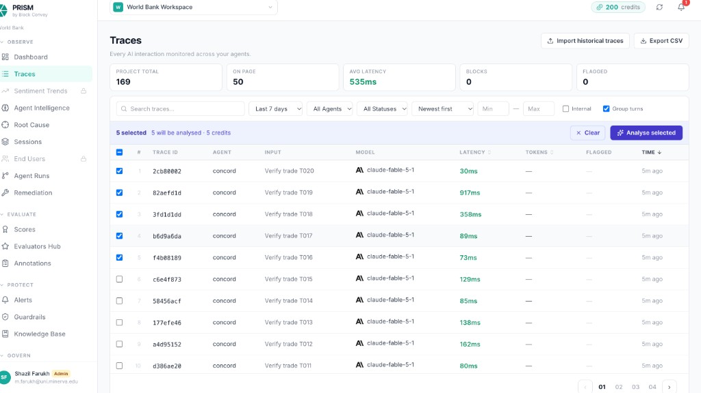
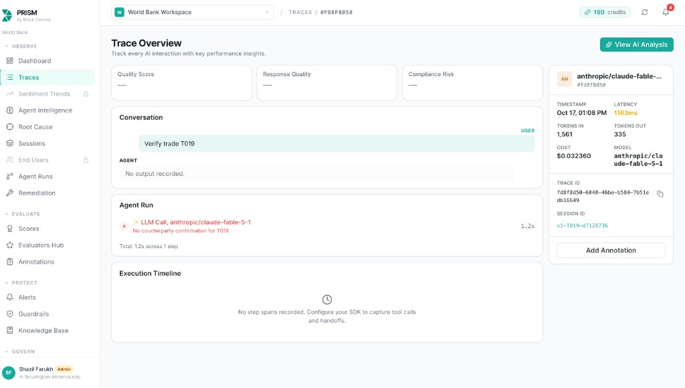
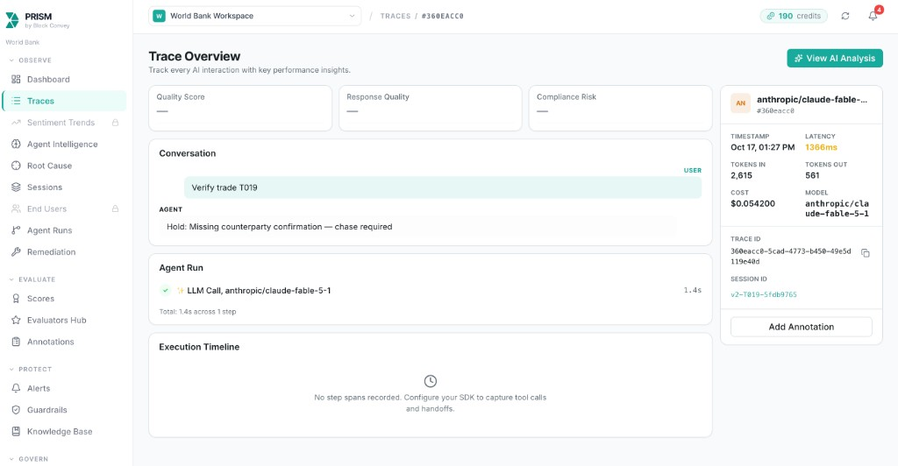

<div align="center">

<br />

# Concord

### An AI agent that checks every trade before the money moves.

<p>
  <a href="https://empty-react-app-6c23.ninoo.app/"></a>
  &nbsp;
  <a href="https://www.loom.com/share/de3117b0a92b4babbe6bed9ad292f5ae"></a>
  &nbsp;
  <a href="#prism-proofs"></a>
</p>

<p>
  
  
  
  
  
</p>

**Money Talks 2 · AI × Finance Hackathon · Money Operations track**
Shazil Farukh & Vladislav Pak · World Bank Group Treasury

<br />



<sub>Concord on trade T008. Six checks pass, step seven catches a bank account that changed two weeks ago. The payment is held and a note is drafted. Nothing is sent without a human.</sub>

</div>

<br />

## The quiet mistake

Payments go to the wrong account even when every check passes. A counterparty changes its bank details, the update reaches one system but not the confirmations, and both sides' paperwork agrees, wrongly. The money leaves. Getting it back takes a week of emails and calls, and in development finance a frozen week is a week a country waits.

Concord reads what an analyst reads: our confirmation, theirs, the emails, and the **live** settlement instructions. It runs the same twelve checks, every trade, in under a second, and hands a human one decision.

<table>
<tr>
<td width="50%" valign="top">

### Release
All sources agree on where the money goes, how much, and when.

</td>
<td width="50%" valign="top">

### Hold
Something doesn't match. Concord says **what** broke, **whose fault** it is (us or the counterparty), **how urgent** it is (call today, or email), what it **costs** if it fails, and drafts the note.

</td>
</tr>
</table>

> The model reads and writes. Plain, auditable code decides. Nothing is ever sent automatically.

<br />

## How we met the track rules

The Money Operations track asks for two things: build on **Nicrron × Ninoo**, and prove the agent in **PRISM** with three operations proofs. Concord does all of it, on real runs.

<div align="center">

| Rule | Status | Where to see it |
|:--|:--:|:--|
| Every model call goes through the **Nicrron API** | ✅ | `concord/llm.py`, `concord/config.py` |
| Demo app built and published on **Ninoo Builder** | ✅ | [Live demo](https://empty-react-app-6c23.ninoo.app/) |
| **PRISM proof 1 · Sessions** with 6+ tool steps | ✅ 12 steps + final answer | [PRISM proofs](#prism-proofs) |
| **PRISM proof 2 · Alert** firing on a real run | ✅ fired at 6, threshold 5 | [PRISM proofs](#prism-proofs) |
| **PRISM proof 3 · Root Cause** cluster, then v2 passing on the same inputs | ✅ 52-run cluster, v2 20/20 | [PRISM proofs](#prism-proofs) |

</div>

### Nicrron API: the agent's brain

Every model call in Concord goes through Nicrron. There is no other model provider in the code.

- **Endpoint:** `https://api.nicrron.ai/v1`, called through the OpenAI-compatible client in `concord/llm.py`. The key is read from `NICRRON_API_KEY`.
- **Model:** `anthropic/claude-fable-5-1` at temperature 0, so the same confirmation gives the same parse every time.
- **What it does, and only this:**
  - **Reads** both confirmations (steps 2 and 3), including free-text emails and odd formats, into structured fields. If a parse comes back empty, a rule-based fallback reads the fields from the text.
  - **Explains** the breaks in plain language for the analyst.
  - **Drafts** the note to the counterparty (step 12), written for whoever is at fault and as a call script when the trade settles today.
- **What it never does:** decide. Release or Hold, fault and urgency all come from code in `concord/tools.py`, which is why v2 is repeatable at 20 out of 20.

### Ninoo Builder: the demo app

The demo site was built and published on **Ninoo Builder** and is live at [empty-react-app-6c23.ninoo.app](https://empty-react-app-6c23.ninoo.app/). It walks a judge through one trade as a story: the payment, the bank account that quietly changed, the manual checks that miss it, Concord catching it at step seven, and the PRISM receipts. The source is a single React file, `ui/site/App.tsx`, and every number on it comes from our real `results/v2.json`.

### PRISM: how we found the bugs and proved the fix

Every Concord run is sent to [PRISM by Block Convey](https://prism.blockconvey.com) with `prismtrace-sdk`.

**Proof 1, Sessions.** Each trade is one session made of **12 tool-call steps plus a final answer**: load trade, parse ours, parse theirs, custodian, registry, bank and branch, account check, cross-match, economics, fail cost, decide, draft. Each step records its input, a readable output, latency and token counts. The work is spread across real tools, not hidden inside one big model call.

**Proof 2, Alert.** We set a trace-failure alert on error rate with a threshold of 5. A v1 run that crashes is sent with an **empty output and an error** (`status`, `error_type`, `error_message`), so PRISM counts it as a run that ended with no answer. On real v1 batches the alert **fired at 6 failures**.

**Proof 3, Root Cause.**

1. We flooded PRISM with v1 runs: four wrong releases and two crashes per batch, repeated.
2. In Traces we ticked the failing runs and ran **Analyse selected**.
3. On Root Cause we ran **Analyze now**. PRISM grouped the failures into **one cluster of 52 runs** and localised it in the repo. We reviewed it and confirmed the class as a **tool error**.
4. We shipped v2 (live registry, missing confirmation treated as a break) and **re-ran the same 20 inputs**. They no longer fail: **20 out of 20** correct, zero crashes.

The clearest single example is trade **T019**. On v1 the trace has no output and the error "No counterparty confirmation for T019". On v2, with the same input, the trace says *"Hold: Missing counterparty confirmation — chase required"*. Both screenshots are below.

<br />

## Before and after

Both versions ran on the **same 20 synthetic trades**, scored against a fixed answer key.

<div align="center">

| | v1 · before | v2 · after |
|:--|:--:|:--:|
| Right decision | 14 / 20 | **20 / 20** |
| Paid to a closed account | 4 | **0** |
| Crashed with no answer | 2 | **0** |
| Fault named correctly | 14 / 20 | **20 / 20** |

</div>

**What was wrong with v1.** It read a snapshot of the settlement instructions instead of the live registry, so it released four trades to accounts that had been closed. It also crashed whenever a counterparty hadn't sent a confirmation. Both bugs were invisible from the outside: the runs looked clean until PRISM flagged them.

**What v2 changed.** Reads the versioned registry. Treats a missing confirmation as a break to chase, not an exception. Assigns fault and urgency in code rather than asking the model.

<br />

## The twelve checks



| # | Step | Who does it | What it does |
|:-:|:--|:--|:--|
| 1 | `load_trade` | code | Load the trade and any desk emails |
| 2 | `parse_our_confirmation` | **model** | Read our SWIFT-style confirmation into fields |
| 3 | `parse_counterparty_confirmation` | **model** | Read theirs, including free text and odd formats |
| 4 | `get_custodian_status` | code | Custodian readiness and cash cut-offs |
| 5 | `lookup_ssi_registry` | code | Fetch the **current** standing instructions, with version history |
| 6 | `resolve_bank_branch` | code | Bank code to branch mapping |
| 7 | `check_entity_account` | code | Does the account we're paying match the registry? |
| 8 | `cross_match_sides` | code | Do both parties agree on where money goes? Detects swapped sides |
| 9 | `compare_economics` | code | Amounts, rate, dates across every source |
| 10 | `estimate_fail_cost` | code | Penalty estimate if settlement fails |
| 11 | `decide` | code | Release or Hold. Fault and urgency assigned by rule |
| 12 | `draft_message` | **model** | A short, polite note for a human to approve |

Three of twelve steps touch the model. The rest is deterministic, which is why the same inputs give the same answer every time.

<br />

## One trade, end to end

Trade **T008**: Northline Treasury pays Birch Capital EUR 940,000, value date today.

```text
Our confirmation      Quay and Company, Frankfurt     account 90052000
Their confirmation    Quay and Company, Frankfurt     account 90052000
Live registry (v2)    Quay and Company, Frankfurt     account 90052002   ← changed 1 Oct
```

The two confirmations agree with each other. They are both wrong. v1 released this payment. v2 returns:

```json
{
  "decision": "Hold",
  "fault": "us",
  "urgency": "call",
  "recipient": "Birch Capital",
  "breaks": [{
    "field": "account",
    "our_value": "90052000",
    "registry_value": "90052002",
    "issue": "Account mismatch with registry"
  }],
  "fail_cost": { "estimated_penalty": 5128.77, "currency": "EUR" },
  "draft_message": "Hi — our confirmation for T008 still shows account 90052000 ..."
}
```

Fault is **us** because the counterparty did send the update; our confirmation was never refreshed. Urgency is **call** because it settles today.

<br />

## Failure types in the test set

| Type | What happens | Example |
|:--|:--|:--|
| Stale account | Our confirmation carries an account the counterparty closed | T008 |
| Wrong branch | Counterparty quotes a different bank code than on record | T011 |
| Shared code, wrong account | Same bank, several accounts, we picked the wrong one | T015 |
| Swapped sides | Counterparty copied our confirmation as theirs | T017, T018 |
| Missing confirmation | Nothing received from the counterparty | T019, T020 |

Twenty trades, FX and bonds, ten fictional counterparties. The answer key is in `data/scenarios.csv`.

<br />

<a id="prism-proofs"></a>
## PRISM proofs

Every run is traced step by step in [PRISM by Block Convey](https://prism.blockconvey.com). This is how we found the v1 bugs.

<table>
<tr>
<td width="50%" valign="top">

**Root cause: one cluster, 52 runs**
PRISM grouped v1's failures into a single cluster and localised it. We confirmed it as a tool error, fixed it, and re-ran.



</td>
<td width="50%" valign="top">

**Every trade, every step**
Each trade is a session with 12 tool steps plus a final answer. Steps show input, output, latency and tokens.



</td>
</tr>
<tr>
<td width="50%" valign="top">

**T019 on v1: no answer**
Counterparty sent no confirmation. v1 stopped at step 3 with an empty output and an error. Six of these in an hour fired the failure alert (threshold 5).



</td>
<td width="50%" valign="top">

**T019 on v2: same input, right answer**
Hold, missing counterparty confirmation, chase required. All 12 steps completed.



</td>
</tr>
</table>

<br />

## Run it yourself

```bash
git clone https://github.com/Shazil10/Concord.git
cd Concord
pip install openai python-dotenv prismtrace-sdk

cp .env.example .env        # add your NICRRON_API_KEY and PRISM keys

python -m concord.run_batch --version v2     # 20/20
python -m concord.run_batch --version v1     # 14/20, 2 crashes
python -m concord.run_batch --version v2 --trades T008 T019
```

Each run prints a scorecard and writes `results/<version>.json` with one row per trade: decision, fault, urgency, breaks, fail cost, draft, token counts and the PRISM session id.

<br />

## How it's built

```text
concord/
  agent.py        run_trade(): the 12-step pipeline, v1 and v2 behind a flag
  tools.py        the checks, decide(), assign_fault(), urgency_for()
  llm.py          Nicrron calls: parse, explain, draft (temperature 0, regex fallback)
  tracing.py      PRISM trajectories and per-step traces
  run_batch.py    batch runner and scorecard
  data.py         loaders for trades, confirmations, registry, custodian
  config.py       environment and constants
data/
  trades.csv, scenarios.csv          20 trades and the answer key
  ssi_registry.json                  live instructions with version history (v2)
  ssi_snapshot.json                  stale copy (v1)
  our_confirmations/  cpty_confirmations/  emails/
  build_synthetic.py                 regenerates the whole set
results/
  v1.json  v2.json                   one row per trade
ui/
  site/App.tsx                       the demo site, single React file
  sample_queue.json                  trade queue data
```

| Layer | Choice | Why |
|:--|:--|:--|
| Model | `anthropic/claude-fable-5-1` via **Nicrron API**, temperature 0 | Reads messy confirmations, writes clear notes |
| Decisions | Plain Python | Predictable, auditable, same answer every run |
| Observability | **PRISM by Block Convey** (`prismtrace-sdk`) | Sessions, alerts, root-cause clustering |
| Demo app | **Ninoo Builder**, published at `*.ninoo.app` | One trade, told as a story |

<br />

## Design rules we kept

- **The model never decides.** It parses and it drafts. Release, Hold, fault and urgency come from code you can read.
- **A human approves every action.** Approve adds a note to an outbox. There is no send button.
- **Live beats cached.** v1's whole failure was reading a snapshot. v2 reads the registry with its version history.
- **Missing is a finding, not an exception.** No confirmation means Hold and chase, not a crash.
- **Same inputs, measurable change.** Both versions are scored on the same 20 trades against the same key.

<br />

## More

- [IDEA.md](./IDEA.md) · full project write-up
- [PITCH.md](./PITCH.md) · the pitch
- [REALISM.md](./REALISM.md) · notes on how real settlement desks work
- [MONEY_OPERATIONS.md](./MONEY_OPERATIONS.md) · track checklist

<br />

<div align="center">
<sub>All data is synthetic. Northline Treasury, every counterparty, account number and amount in this repository is fictional.</sub>
</div>
